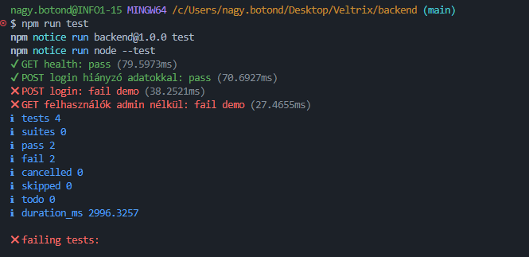

# Tesztelési dokumentáció

## 1. A feladat leírása

A tesztelés célja a Veltrix használt autókat kezelő backend alkalmazás alapvető HTTP-végpontjainak ellenőrzése.

A vizsgált tesztfájl:

- `backend/tests/server.test.js`

A tesztek az alkalmazást helyi, véletlenszerű portra indítják, majd HTTP-kérésekkel ellenőrzik a végpontok válaszait.

## 2. A tesztelés célja

A tesztelés annak ellenőrzésére szolgál, hogy:

- az egészségügyi ellenőrző végpont sikeres választ ad-e;
- a hiányos bejelentkezési adatok megfelelő hibakódot eredményeznek-e;
- a bejelentkezési végpont hibás kérés esetén ne adjon sikeres választ;
- a felhasználók lekérdezése adminisztrátori jogosultság nélkül megtagadásra kerül-e.

A tesztcsomag 2 sikeres és 2 szándékosan sikertelen tesztesetet tartalmaz. A sikertelen esetek bemutatják, hogy a teszt képes felismerni a várt és a tényleges eredmény közötti eltérést.

## 3. Tesztelési környezet

| Tulajdonság | Érték |
| --- | --- |
| Programozási nyelv | JavaScript |
| Tesztelés típusa | Integrációs teszt / HTTP-végpont teszt |
| Tesztelt alkalmazás | Veltrix backend |
| Tesztfájl | `backend/tests/server.test.js` |
| Tesztelési eszköz | Node.js |
| Tesztelési keretrendszer | Node.js beépített `node:test` modulja |
| Ellenőrzés | Node.js beépített `assert/strict` modulja |
| Tesztparancs | `npm test` |

## 4. Tesztesetek meghatározása

| Teszt ID | Teszt megnevezése | Kérés | Elvárt eredmény | Teszt típusa |
| --- | --- | --- | --- | --- |
| T01 | Health végpont ellenőrzése | `GET /api/health` | HTTP `200` | Sikeres |
| T02 | Bejelentkezés hiányzó adatokkal | `POST /api/auth/login`, üres JSON törzs | HTTP `400` | Sikeres |
| T03 | Bejelentkezés hibás elvárással | `POST /api/auth/login`, üres JSON törzs | A teszt `200`-at vár, a tényleges eredmény `400` | Sikertelen |
| T04 | Felhasználók lekérése jogosultság nélkül | `GET /api/felhasznalok` | A teszt `200`-at vár, a tényleges eredmény `403` | Sikertelen |

## 5. Tesztelési megvalósítás

A tesztek a Node.js beépített tesztelési eszközeit használják. A backend tesztelés előtt elindul egy memóriában működő munkamenettárolóval, a tesztek pedig `fetch()` segítségével küldenek HTTP-kéréseket.

A sikeres tesztek:

```javascript
test('GET health: pass', async () =>
    assert.equal((await fetch(`${url}/api/health`)).status, 200));

test('POST login hiányzó adatokkal: pass', async () =>
    assert.equal((await login()).status, 400));
```


A szándékosan sikertelen tesztek:

```javascript
test('POST login: fail demo', async () =>
    assert.equal((await login()).status, 200));

// A tényleges válasz 400, ezért a 200-as elvárás miatt a teszt sikertelen.
test('GET felhasználók admin nélkül: fail demo', async () =>
    assert.equal((await fetch(`${url}/api/felhasznalok`)).status, 200));

// A tényleges válasz 403, ezért a 200-as elvárás miatt a teszt sikertelen.
```

## 6. Teszteredmények

A teszteket a `backend` könyvtárban az `npm test` paranccsal futtatva az alábbi eredmény született:

| Teszt ID | Elvárt eredmény | Tényleges eredmény | Állapot |
| --- | --- | --- | --- |
| T01 | `200` | `200` | Sikeres |
| T02 | `400` | `400` | Sikeres |
| T03 | `200` | `400` | Sikertelen, az eltérés szándékos |
| T04 | `200` | `403` | Sikertelen, az eltérés szándékos |

Összesítés:

- Tesztek száma: `4`
- Sikeres tesztek: `2`
- Sikertelen tesztek: `2`

## 7. Összegzés

A tesztelés igazolta, hogy az alkalmazás egészségügyi végpontja megfelelően működik, valamint a hiányos bejelentkezési kérésre `400`-as hibakódot ad.

A két sikertelen teszt bemutató célú. Ezek nem feltétlenül backend-hibát jeleznek: a tesztekben szándékosan helytelen, `200`-as elvárás szerepel, miközben az alkalmazás helyesen `400`-as, illetve `403`-as választ küld. A tesztelési feladat szempontjából ezért mind a 2 sikeres, mind a 2 sikertelen teszteset eredménye dokumentálva van.
