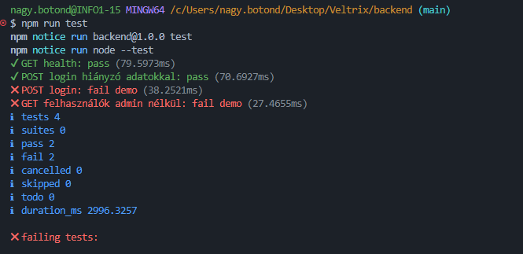

# Tesztelési dokumentáció

## 1. A feladat leírása

A tesztelés célja a Veltrix alkalmazás (használtautó-kereskedés és tuning alkatrész webshop) működésének ellenőrzése, három szinten:

- **unit tesztek:** egy-egy függvény önmagában (pl. az autó adatainak ellenőrzése, a dashboard számításai, a számla adatai);
- **integrációs tesztek:** a valódi backend API, valódi (memóriában futó) MongoDB adatbázissal;
- **E2E (végponttól végpontig) tesztek:** a teljes weboldal böngészőben, Cypress-szel.

A dokumentum 2–7. fejezete a backend alap HTTP-végpontjait vizsgáló `backend/tests/server.test.js` fájlt mutatja be részletesen (benne a szándékosan sikertelen tesztekkel). A 8. fejezet a teljes tesztcsomagot sorolja fel.

## 2. A tesztelés célja

A `server.test.js` tesztjei azt ellenőrzik, hogy:

- az egészségügyi ellenőrző végpont sikeres választ ad-e;
- az API válaszaiban benne vannak-e a biztonsági fejlécek;
- a hiányos bejelentkezési adatok megfelelő hibakódot eredményeznek-e;
- a dashboard bejelentkezés nélkül nem érhető-e el;
- a felhasználók lekérdezése adminisztrátori jogosultság nélkül megtagadásra kerül-e.

A fájl 4 sikeres és 2 szándékosan sikertelen tesztesetet tartalmaz. A sikertelen esetek azt mutatják be, hogy a teszt képes felismerni a várt és a tényleges eredmény közötti eltérést.

## 3. Tesztelési környezet

| Tulajdonság | Érték |
| --- | --- |
| Programozási nyelv | JavaScript (Node.js 22+) |
| Tesztelés típusa | unit, integrációs (HTTP-végpont) és E2E teszt |
| Tesztelt alkalmazás | Veltrix backend és frontend |
| Tesztelési keretrendszer (backend) | Node.js beépített `node:test` modulja |
| Ellenőrzés | Node.js beépített `assert/strict` modulja |
| Adatbázis a tesztekhez | `mongodb-memory-server` (memóriában futó MongoDB, minden teszt előtt kiürítve) |
| E2E eszköz | Cypress 16 (külön tesztszerverrel: `backend/tests/e2e/szerver.js`) |
| Tesztparancsok | `npm test` (backend), `npm run e2e` (frontend) |

A tesztek nem használják az éles adatbázist és a külső szolgáltatásokat: a Cloudinary (képfeltöltés), a Stripe (fizetés), a Billingo (számlázás) és az e-mail küldés helyett a tesztek kamu függvényeket használnak, amelyek megjegyzik, hogy mit kellett volna csinálniuk.

## 4. Tesztesetek meghatározása (`server.test.js`)

| Teszt ID | Teszt megnevezése | Kérés | Elvárt eredmény | Teszt típusa |
| --- | --- | --- | --- | --- |
| T01 | Health végpont ellenőrzése | `GET /api/health` | HTTP `200` | Sikeres |
| T02 | Biztonsági fejlécek | `GET /api/health` | `X-Frame-Options: DENY`, szigorú CSP, `nosniff`, nincs `X-Powered-By` | Sikeres |
| T03 | Bejelentkezés hiányzó adatokkal | `POST /api/auth/bejelentkezes`, üres JSON törzs | HTTP `400` | Sikeres |
| T04 | Dashboard bejelentkezés nélkül | `GET /api/admin/dashboard` | HTTP `403` | Sikeres |
| T05 | Bejelentkezés hibás elvárással | `POST /api/auth/bejelentkezes`, üres JSON törzs | A teszt `200`-at vár, a tényleges eredmény `400` | Sikertelen |
| T06 | Felhasználók lekérése jogosultság nélkül | `GET /api/felhasznalok` | A teszt `200`-at vár, a tényleges eredmény `403` | Sikertelen |

## 5. Tesztelési megvalósítás

A teszt előtt a backend egy véletlen porton elindul (adatbázis nélkül, memóriában tárolt munkamenettel), a tesztek pedig `fetch()` segítségével küldenek HTTP-kéréseket.

Sikeres tesztek (részlet):

```javascript
test('GET health: pass', async () => {
    const valasz = await fetch(url + '/api/health');
    assert.equal(valasz.status, 200);
});

test('POST login hiányzó adatokkal: pass', async () => {
    const valasz = await login();
    assert.equal(valasz.status, 400);
});
```



A szándékosan sikertelen tesztek:

```javascript
// Ez a két teszt szándékosan rossz, a tesztelési dokumentációban a sikertelen teszt példája.
test('POST login: fail demo', async () => {
    const valasz = await login();
    assert.equal(valasz.status, 200); // valójában 400 jön
});

test('GET felhasználók admin nélkül: fail demo', async () => {
    const valasz = await fetch(url + '/api/felhasznalok');
    assert.equal(valasz.status, 200); // valójában 403 jön
});
```

## 6. Teszteredmények (`server.test.js`)

| Teszt ID | Elvárt eredmény | Tényleges eredmény | Állapot |
| --- | --- | --- | --- |
| T01 | `200` | `200` | Sikeres |
| T02 | biztonsági fejlécek | megvannak | Sikeres |
| T03 | `400` | `400` | Sikeres |
| T04 | `403` | `403` | Sikeres |
| T05 | `200` | `400` | Sikertelen, az eltérés szándékos |
| T06 | `200` | `403` | Sikertelen, az eltérés szándékos |

## 7. Összegzés (`server.test.js`)

A tesztelés igazolta, hogy az alkalmazás egészségügyi végpontja megfelelően működik, a válaszokban benne vannak a biztonsági fejlécek, a hiányos bejelentkezési kérésre `400`-as, a jogosultság nélküli kérésekre `403`-as hibakódot ad.

A két sikertelen teszt bemutató célú. Ezek nem backend-hibát jeleznek: a tesztekben szándékosan helytelen, `200`-as elvárás szerepel, miközben az alkalmazás helyesen `400`-as, illetve `403`-as választ küld.

## 8. A teljes tesztcsomag

### 8.1 Futtatás

| Parancs | Hol | Mit futtat |
| --- | --- | --- |
| `npm test` | `backend` | az összes unit és integrációs teszt |
| `npm run test:egyseg` | `backend` | csak a unit tesztek |
| `npm run test:integracio` | `backend` | csak az integrációs tesztek |
| `npm run e2e` | `frontend` | a Cypress E2E tesztek (elindítja a tesztszervert és a frontendet is) |
| `npm run e2e:open` | `frontend` | a Cypress ablaka, a tesztek egyenként futtathatók |

### 8.2 Unit tesztek (`backend/tests/*.test.js`)

**`autoAdatok.test.js`** – az autó űrlap ellenőrzése, szűrés, slug

- érvényes autóadatok: nincs hiba, alapértékek beállnak
- hiányzó kötelező mező és kép nélküli autó: hiba
- ismeretlen váltó, hibás alvázszám és tört évjárat: hiba
- idegen domainről származó kép nem fogadható el
- felszereltség: ismétlődések és üres elemek kiszűrve
- állapotmódosítás: csak az engedélyezett mezők, érvényes státusz
- slug: ékezetek eltávolítva, azonosító visszanyerhető
- szűrő: tartományok, többes érték és nyilvános feltételek
- szűrő: reguláris kifejezés karakterei nem törik el a keresést
- mentett keresés: ismeretlen kulcsok eldobva
- nyilvános válasz: belső adatok rejtve, régi egyképes rekord képtömbbé alakul

**`dashboard.test.js`** – a dashboard számításai

- időszak: ismert kulcs, ismeretlen esetén 30 nap, „osszes” határ nélkül
- budapesti nap: UTC éjfél előtt már a következő nap
- napi és havi kulcsok: a mai nappal / folyó hónappal zárnak, évhatáron is
- idősor: a hiányzó kulcsok 0 értéket kapnak, az ismeretlenek kimaradnak
- változás: százalék egy tizedesre, 0 vagy hiányzó előzménynél null
- kategóriák: csökkenő sorrend, a sok kategória vége „Egyéb”
- ársávok: minden sáv szerepel, az üresek 0-val
- eladás: elkelt autónál a dátum és az ár (vételár) automatikusan kitöltődik
- eladás: megadott eladási ár megmarad, visszaállításkor törlődik
- eladási adatok validálása: jövőbeli dátum és negatív ár hiba

**`szamlazas.test.js`** – a Billingónak küldött számla adatai (új)

- számla adatai: bruttó árak 27% ÁFA-val, szállítás és kezelési díj külön sorban (a tételek összege egyezik a végösszeggel)
- ingyenes szállításnál nincs szállítási sor; kártyánál online bankkártya a fizetési mód
- partner: magánszemély adószám nélkül, cég adószámmal

**`server.test.js`** – lásd a 2–7. fejezetet.

### 8.3 Integrációs tesztek (`backend/tests/integracio/*.test.js`)

Minden teszt előtt üres adatbázis indul. A tesztek bejelentkezett klienseket használnak (vendég, vásárló, értékesítő, admin), és HTTP-kérésekkel ellenőrzik az API-t.

**`autok.test.js`** – hirdetések

- értékesítő hirdetést hoz létre; a belső statisztikát látja, a pénzügyi adatot nem
- elkelt státusz: az eladási dátum és ár automatikusan kitöltődik, visszaállításkor törlődik
- értékesítő szerkesztése nem írja felül az admin által rögzített eladási árat
- értékesítő új eladott autónál nem adhat meg eladási árat (a vételár lesz)
- nyilvános nézet: rejtett és eladott autó kimarad, belső adatok nem kerülnek ki
- szűrés és rendezés a nyilvános listában
- törlés: értékesítőnek tiltott; adminnál a képek és a kedvencek is takarítva
- megtekintés számlálása: látogatónál nő, munkatársnál nem

**`jogosultsagok.test.js`** – szerepkörök és fiókbiztonság

- jogosultsági mátrix: 24 védett végpont × 4 szerepkör (vendég, vásárló, értékesítő, admin)
- /auth/profil: a jogok listája a szerepkörhöz igazodik
- admin értékesítőt hoz létre; ismeretlen szerepkör elutasítva
- lefokozás azonnal érvényes, a munkamenet nem őrzi meg a régi jogot
- a nyilvános regisztráció nem adhat munkatársi szerepkört
- az új regisztráció e-mail-megerősítésig nem léptethető be
- a jelszó-visszaállítás nem árulja el, létezik-e az e-mail-cím
- érvénytelen vagy lejárt tokennel nem módosítható e-mail vagy jelszó

**`dashboard.test.js`** – a dashboard ismert adatokkal, kézzel kiszámolt elvárt értékekkel

- bevétel: időszak, előző időszak, változás, átlagok (30 nap)
- készlet: darab, érték, állásidő, státuszok, kategóriák, ársávok
- márkák és telephelyek: készlet és időszaki bevétel összefésülve
- teljes időszak: nincs előző időszak; ismeretlen időszak → 30 nap
- érdeklődések: státuszok, időszak, napi idősor
- értékesítő: a dashboard pénzügyi adatok nélkül érkezik
- üres adatbázis: minden nulla, nincs hiba

**`erdeklodesek.test.js`** – érdeklődés az autókról

- érdeklődés: beérkezik, az értékesítő kezeli, de nem törölheti
- spamszűrés: kitöltött rejtett mező vagy túl gyors kitöltés → látszólag siker, de nem mentjük
- rejtett autóra nem lehet érdeklődni

**`webshop-termekek.test.js`** – alkatrészek

- termék létrehozása: validáció, ismétlődő cikkszám, kompatibilitás kötelező
- „Melyik autódhoz?” szűrés: márka, modell, évjárat; az univerzális mindig illik
- platformra megadott alkatrész a részletesebb modellnevű autóra is illik (szavas előtag)
- ár szerinti rendezés és szűrés az akciós árral számol
- autó adatlapja: előbb a típusra illők, aztán az univerzálisak
- szűrőadatok, adatlap, gyors módosítás és törlés jogosultsággal
- képvédelem: autó képe nem rendelhető termékhez, és a takarítás nem törli a termék képét

**`webshop-rendelesek.test.js`** – kosár és rendelés

- kosár: a szerver számol (akciós ár, ingyenes szállítási határ, utánvét díja), hibák jelezve
- rendelés utánvéttel: készlet csökken, végösszeg a szerverről, visszaigazolás csak kulccsal
- hiányzó készlet: 409, és a már lefoglalt tételek visszakerülnek
- párhuzamos rendelés az utolsó darabra: pontosan egy sikerül
- lemondás: a készlet egyszer kerül vissza; lemondott rendelés nem állítható vissza
- előre utalás: fizetés rögzítéséig nem dolgozható fel; a státuszok a szállítási módhoz igazodnak
- rendelés validáció: hiányzó adatok, ÁSZF, fizetési mód a szállításhoz

**`webshop-fizetes.test.js`** – kártyás fizetés (Stripe webhook, aláírással)

- kártyás fizetés: átirányítás, aláírt visszajelzés → fizetve; hamis aláírás elutasítva
- lejárt fizetés: a rendelés lemondva, a készlet felszabadul – de csak az aktuális munkamenetre
- ha az online fizetés nem indul el: 502, a rendelés lemondva, a készlet visszakerül
- dashboard webshop-blokk: rendelések és bevétel; értékesítőnél forintösszeg nélkül

**`webshop-takaritas.test.js`** – automatikus lemondás és visszatérítés (új)

- átutalás: 8 nap után automatikusan lemondva, a készlet visszakerül; a friss rendelés marad (és másodszorra nem duplázódik a készlet)
- kártya: elveszett „lejárt” visszajelzés után a takarítás lemondja a rendelést (de 45 percen belül még vár)
- kártya: ha a Stripe szerint kifizették (csak a webhook veszett el), a fizetést rögzítjük
- kártya: ha a Stripe nem elérhető, nem mondjuk le (legközelebb újra próbáljuk)
- admin lemondja a kifizetett kártyás rendelést: a Stripe visszatéríti az összeget
- ha a visszatérítés nem sikerül, a rendelés nem lesz lemondva, és a készlet sem változik
- nem kifizetett vagy utánvétes rendelés lemondásakor nincs visszatérítés

**`webshop-szamlazas.test.js`** – számlázás (új)

- átutalás: a fizetés rögzítésekor elkészül a számla, a vevő csak a számát látja
- utánvét: a számla a teljesítéskor készül el, egyszer
- ha a számla nem készül el, a hiba elmentődik, és az adminban újra lehet próbálni
- kifizetett, számlázott rendelés lemondásakor a számlát sztornózzuk
- számla nélküli (ki nem fizetett) rendeléshez nem kérhető számla

### 8.4 E2E tesztek (`frontend/cypress/e2e/*.cy.js`)

A tesztszerver minden teszt előtt visszaállítja az ismert tesztadatokat (3 felhasználó, 4 autó, 5 alkatrész, 1 telephely). Tesztfelhasználók: `admin@teszt.hu`, `ertekesito@teszt.hu`, `vasarlo@teszt.hu`, jelszó: `Teszt1234`.

| Fájl | Tesztek | Mit tesztel |
| --- | :---: | --- |
| `bejelentkezes_teszt.cy.js` | 7 | belépés a menüből és visszairányítás, hibás jelszó, admin belépés, kijelentkezés, védett oldal; regisztráció e-mail-megerősítéssel, foglalt e-mail-cím |
| `autok.cy.js` | 4 | kínálat és márkaszűrő, adatlap az illő alkatrészekkel, érdeklődés küldése, kedvencek |
| `webshop.cy.js` | 7 | „Melyik autódhoz?” szűrés, kategória/akció/rendezés, termékoldal; kosár, rendelés utánvéttel és átutalással, elfogyott termék a pénztárban |
| `fizetes.cy.js` | 2 | kártyás fizetés sikeres és lejárt esete (Stripe visszajelzés szimulálásával) |
| `admin.cy.js` | 6 | dashboard, rendeléskezelés e-mail értesítéssel, készlet és láthatóság, új termék; értékesítő és vásárló jogai |
| `mobil.cy.js` | 8 | mobil menü, kosár és pénztár telefon méreten, süti-tájékoztató |

### 8.5 Eredmények

| Tesztcsomag | Tesztek | Sikeres | Sikertelen |
| --- | :---: | :---: | :---: |
| Backend (`npm test`): unit + integrációs | 86 | 84 | 2 (szándékos, T05 és T06) |
| E2E (`npm run e2e`) | 34 | 34 | 0 |

### 8.6 A tesztek által megtalált hibák (példák)

A tesztek fejlesztés közben valódi hibákat is megtaláltak. Néhány példa:

- **Elakadó számlázás:** ha a számla kiállítása egyszer nem sikerült, a „számla készül” jelzés bent maradt az adatbázisban, így az újrapróbálás sem működött. Ezt a `webshop-szamlazas.test.js` vette észre, és javítva lett.
- **Kijelentkezés védett oldalról:** a Fiók oldalról kijelentkezve az oldal a belépésre irányított a főoldal helyett. Ezt a Cypress kijelentkezés-tesztje mutatta ki, és javítva lett.
- **Regisztráció:** a regisztrációs E2E teszt az e-mail-megerősítés bevezetése után elbukott, ezért a tesztet az új folyamathoz igazítottuk.
